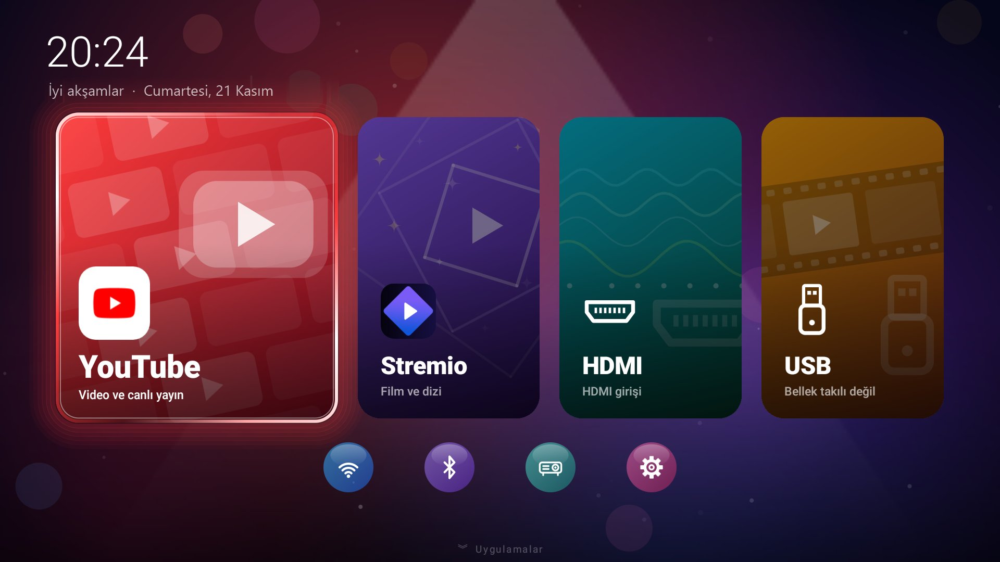

# Perde

**HY350 projeksiyon cihazı için sade, sessiz ve hızlı bir ana ekran.**
*A clean, silent and fast home screen for the HY350 projector — [English below](#english).*



🌐 Tanıtım sayfası: **https://acarplus.github.io/perde/**
⬇️ İndir: [Son sürüm (APK)](https://github.com/AcarPlus/perde/releases/latest)

## Neler var

- **Dört büyük panel:** YouTube, Stremio, HDMI ve USB. Her panelin kendi canlı sahnesi var.
- **Kaldığın yerden devam:** YouTube/Stremio'da en son izlediğin şeyin kapağı, adı ve ilerlemesi panelde görünür.
- **Kendi Wi-Fi ve Bluetooth ekranları:** ağ seçip şifreyle bağlanma; hoparlör/kulaklık eşleştirme ve bağlama.
- **Görüntü ayarları:** parlaklık, kontrast, renk doygunluğu, renk sıcaklığı, kırmızı/yeşil/mavi dengesi ve hazır profiller (Sinema, Sıcak, Soğuk, Canlı, Göz dostu). Ayarlar anında uygulanır ve açılışta geri gelir.
- **4 köşe düzeltme:** üreticinin yöntemiyle, kumandanın ok tuşlarıyla.
- **USB bellek:** takınca "Aç?" sorar, filmleri VLC ile açar.
- **HDMI:** tek tuşla açılır; kablo takılınca haber verir.
- **Sessiz ve serin:** arayüz sesi yok, 30 sn işlem yoksa animasyonlar durur, 5 dk sonra bekleme saati. Kare hızı 30'un altına düşerse efektler kendiliğinden hafifler.
- Temalar, uyku zamanlayıcısı, gece modu, arka plan temizliği.

Kumanda: ok tuşları + OK. **Ayarlar** baloncuğu: tek basış Perde ayarları, uzun basış üreticinin ayarları.

## Uyumluluk — önce okuyun

Perde, Wi-Fi'ye bağlanmak, hoparlöre bağlanmak, 4 köşe ve renk ayarı yapabilmek için **sistem uygulaması** olarak imzalıdır
(Android'in herkese açık *AOSP test anahtarı* ile). Bu yüzden yalnızca bu anahtarla üretilmiş cihazlara kurulabilir.

- Geliştirildiği ve denendiği cihaz: **HY350** (Android TV 11, Allwinner, HTC arayüzü).
- Başka bir cihazda kurulum `INSTALL_FAILED_SHARED_USER_INCOMPATIBLE` hatasıyla reddedilirse cihaz uyumlu değildir; cihaza zarar gelmez.
- Sistem uygulaması olduğu için geniş yetkileri vardır. Kendi sorumluluğunuzda kullanın.

## Kurulum (bilgisayardan, ADB ile)

1. Projeksiyonda geliştirici seçeneklerinden **ağ üzerinden ADB**'yi açın ve IP adresini öğrenin.
2. [Android platform-tools](https://developer.android.com/tools/releases/platform-tools) indirin, sonra:

```powershell
adb connect <projeksiyon-ip>:5555
adb install perde.apk
adb shell cmd package set-home-activity com.perde.launcher/.MainActivity
```

İsteğe bağlı — "kaldığın yerden devam" için bildirim erişimi:

```powershell
adb shell cmd notification allow_listener com.perde.launcher/com.perde.launcher.MediaWatcher
```

**Geri dönmek:** `adb uninstall com.perde.launcher` — eski ana ekran kendiliğinden geri gelir.
Ya da projeksiyonda: Ayarlar › Uygulamalar › Perde › Kaldır.

### Ok tuşlarında "tık" sesi mi var?

Ses Perde'den değil, cihazın Android Klavyesinden gelir (klavye görünmezken bile her ok tuşunda ses çalar).
Kapatmak için **Android Klavye Ayarları › Tercihler › "Tuşa basıldığında ses çıkar"** seçeneğini kapatın.

## Derleme

Gradle gerekmez; `build.ps1` aapt2 → javac → d8 → zipalign → apksigner zincirini çalıştırır. `_tools/` altına:

| Klasör | İçerik |
|---|---|
| `_tools/jdk/<jdk-17>/` | JDK 17 |
| `_tools/bt/<sürüm>/` | Android build-tools (aapt2, d8, zipalign, apksigner) |
| `_tools/plat/android-11/android.jar` | Android 11 platformu |
| `_tools/platform-tools/` | adb |
| `_tools/platformkey/` | `platform.pk8` + `platform.x509.pem` — AOSP'nin herkese açık test anahtarı (`build/target/product/security/`) |

```powershell
.\build.ps1            # derler → build\perde.apk
.\build.ps1 -Install   # derler ve kurar (cihaz adresi cihaz.txt dosyasının ilk satırından)
```

## Lisans

[MIT](LICENSE). HTC, YouTube, Stremio ve VLC adları sahiplerinindir; Perde bunlarla bağlantılı değildir.

---

## English

**Perde** ("curtain" in Turkish) is a replacement home screen for the **HY350** Android TV 11 projector: four big panels
(YouTube, Stremio, HDMI, USB) with "continue watching", its own Wi-Fi and Bluetooth screens, picture settings
(brightness, contrast, saturation, colour temperature, RGB balance, presets), 4-corner keystone, USB auto-open in VLC,
no UI sounds and low CPU use when idle. The UI is in Turkish.

**Compatibility:** Perde is signed as a *system app* with the public AOSP test platform key, so it installs only on
devices built with that key (the HY350 is). On other devices the install fails with
`INSTALL_FAILED_SHARED_USER_INCOMPATIBLE` and nothing changes. Use at your own risk.

**Install:** enable network ADB on the projector, then
`adb connect <ip>:5555`, `adb install perde.apk`,
`adb shell cmd package set-home-activity com.perde.launcher/.MainActivity`.
Uninstall with `adb uninstall com.perde.launcher` to get the stock launcher back.

**Key clicks on the D-pad** come from the device's Android Keyboard, not Perde: turn off
*Android Keyboard settings › Preferences › Sound on keypress*.

Build instructions are in the Turkish section above (`build.ps1`, no Gradle). License: [MIT](LICENSE).
